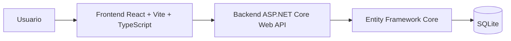
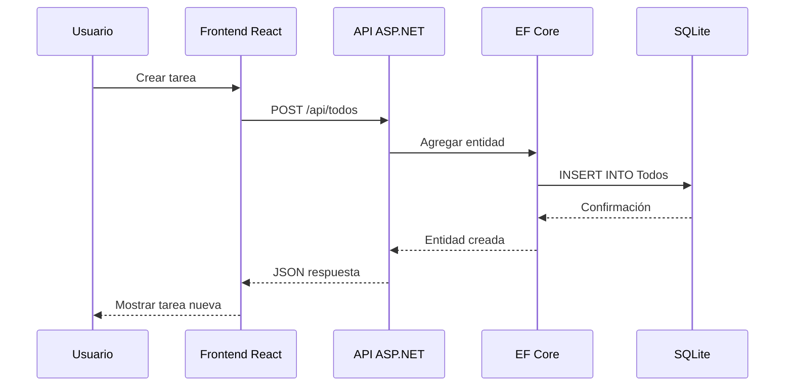

# Análisis de la demo de aplicación de lista de tareas

## 1. Objetivo

Crear una demo de clase de una aplicación de gestión de tareas con una arquitectura moderna y clara, separando responsabilidades entre backend y frontend. La idea es demostrar de forma práctica:

- desarrollo de una API REST en .NET 10
- acceso a datos con Entity Framework Core
- persistencia local con SQLite
- consumo de la API desde un frontend React + Vite + TypeScript
- una estructura simple pero profesional para una aplicación CRUD

## 2. Stack propuesto

### Backend
- .NET 10
- ASP.NET Core Web API
- Entity Framework Core
- SQLite

### Frontend
- React
- Vite
- TypeScript
- Fetch o Axios para consumir la API

## 3. ¿Por qué esta combinación encaja bien?

### 3.1. Backend en .NET 10
.NET sigue siendo una excelente opción para una demo de clase porque ofrece una base sólida para:

- crear APIs rápidas y bien estructuradas
- hacer validación de entrada
- modelar entidades con tipado fuerte
- trabajar con ORM y migraciones
- mantener el código muy legible durante la explicación

### 3.2. Entity Framework Core con SQLite
SQLite es ideal para una aplicación demo por varias razones:

- es muy fácil de configurar
- no requiere un motor de base de datos externo
- permite trabajar en local sin complicaciones
- es suficiente para una pequeña aplicación de lista de tareas
- facilita que los alumnos entiendan la idea de persistencia sin sobrecargar la infraestructura

### 3.3. React + Vite + TypeScript
React con Vite es una de las mejores combinaciones para una demo moderna:

- arranque rápido
- estructura simple para aprender
- excelente DX (developer experience)
- TypeScript ayuda a evitar errores y a enseñar mejores prácticas
- se adapta muy bien a una interfaz con CRUD básico

## 4. Arquitectura recomendada

La separación más clara para esta demo es:

- Backend: gestiona datos y lógica de negocio
- Frontend: gestiona la experiencia de usuario y visualización
- Base de datos: almacena tareas de forma persistente

### Diagrama de arquitectura



## 5. Modelo de datos sugerido

Para una aplicación básica de tareas, el modelo central es muy simple:

```csharp
public class TodoItem
{
    public int Id { get; set; }
    public string Title { get; set; } = string.Empty;
    public string? Description { get; set; }
    public bool IsCompleted { get; set; }
    public DateTime CreatedAt { get; set; }
    public DateTime? UpdatedAt { get; set; }
}
```

### Campos recomendados
- Id: identificador único
- Title: nombre de la tarea
- Description: detalle opcional
- IsCompleted: estado de finalización
- CreatedAt: fecha de creación
- UpdatedAt: última modificación

### Extensiones opcionales
Si se quiere añadir complejidad didáctica, se puede ampliar con:

- Priority
- DueDate
- Category
- UserId

Pero para la demo inicial, lo mejor es mantener el modelo mínimo y claro.

## 6. API REST propuesta

### Endpoints básicos
- GET /api/todos
- GET /api/todos/{id}
- POST /api/todos
- PUT /api/todos/{id}
- DELETE /api/todos/{id}

### Endpoint adicional útil
- PATCH /api/todos/{id}/toggle-complete

### Ejemplo de comportamiento
- Listar todas las tareas
- Crear una nueva tarea
- Editar su texto o estado
- Marcar como completada o incompleta
- Eliminar una tarea

## 7. Estructura del proyecto sugerida

### Backend
```text
TodoApi/
├─ Controllers/
│  └─ TodosController.cs
├─ Data/
│  └─ AppDbContext.cs
├─ Models/
│  └─ TodoItem.cs
├─ DTOs/
│  ├─ CreateTodoDto.cs
│  └─ UpdateTodoDto.cs
├─ Program.cs
├─ appsettings.json
├─ TodoApi.csproj
└─ TodoApi.sln
```

### Frontend
```text
todo-ui/
├─ src/
│  ├─ api/
│  │  └─ todoApi.ts
│  ├─ components/
│  │  ├─ TodoForm.tsx
│  │  ├─ TodoList.tsx
│  │  └─ TodoItem.tsx
│  ├─ types/
│  │  └─ Todo.ts
│  ├─ App.tsx
│  ├─ main.tsx
│  └─ index.css
├─ package.json
├─ vite.config.ts
├─ tsconfig.json
└─ index.html
```

## 8. Flujo de una operación CRUD



## 9. Buenas prácticas recomendadas para la demo

### 9.1. DTOs
Usar DTOs para separar la capa de transporte de las entidades de base de datos.

Ejemplo:

```csharp
public class CreateTodoDto
{
    public string Title { get; set; } = string.Empty;
    public string? Description { get; set; }
}
```

Esto ayuda a:

- validar entradas
- evitar exponer entidades internas
- mantener la API más limpia y segura

### 9.2. Validación
Añadir validación con DataAnnotations o FluentValidation:

- Título obligatorio
- Título no vacío
- Longitud máxima adecuada

### 9.3. CORS
Si el frontend corre en un puerto diferente del backend, será necesario configurar CORS. Es un punto importante de enseñanza.

### 9.4. Migraciones
Entity Framework Core facilita la creación y aplicación de migraciones para entender cómo cambia el esquema de la base de datos.

### 9.5. Separación de responsabilidades
- Controllers: manejar HTTP
- Services: lógica de negocio opcional
- Repository/Data: acceso a datos
- DTOs: contratos de entrada/salida
- Frontend: render y UX

## 10. Decisiones a tomar según el enfoque de la clase

### Enfoque simple
Si el objetivo principal es enseñar CRUD y conexión con BD:

- backend con controllers
- EF Core + SQLite
- frontend con React y varios componentes básicos
- sin autenticación
- sin despliegue a Azure

### Enfoque más completo
Si el objetivo es una demo más profesional:

- capas de servicio
- DTOs y validación
- estructura limpia por dominio
- test simple de API
- manejo de errores global
- diseño más pulido en interfaz

## 11. Qué evitar para no complicar demasiado la demo

- añadir autenticación en la primera iteración
- incluir demasiadas entidades o relaciones
- combinar backend y frontend en un mismo proyecto
- hacer una infraestructura demasiado pesada
- introducir Docker si el objetivo es simplemente enseñar CRUD y arquitectura

## 12. Recomendación final

La mejor elección para una demo de clase es:

- Backend: .NET 10 + ASP.NET Core Web API
- ORM: Entity Framework Core
- Base de datos: SQLite
- Frontend: React + Vite + TypeScript

Esto ofrece una combinación muy equilibrada entre:

- claridad pedagógica
- modernidad tecnológica
- facilidad de ejecución local
- buena separación de capas
- alta legibilidad en una demo de clase

## 13. Propuesta de enunciado para la clase

> Desarrollar una aplicación de gestión de tareas con arquitectura cliente-servidor. El backend se implementará en .NET 10 con ASP.NET Core y Entity Framework Core, utilizando SQLite como base de datos local. El frontend se implementará en React con Vite y TypeScript para consumir la API REST y permitir crear, listar, editar y eliminar tareas. El objetivo es demostrar el flujo completo entre interfaz, backend y persistencia de datos.

## 14. Conclusión

Es una combinación sólida, moderna y muy adecuada para una demo de clase. Tiene la ventaja de que permite enseñar de forma clara conceptos esenciales de desarrollo full stack sin introducir demasiada complejidad operativa.

Si se mantiene simple, bien estructurada y bien explicada, esta app puede convertirse en una excelente demostración de:

- API REST
- acceso a base de datos
- ORM
- consumo de servicios desde frontend
- buenas prácticas de diseño de software

## 15. Siguiente paso recomendado

La siguiente fase ideal sería:

1. crear la estructura del proyecto backend
2. definir la entidad TodoItem
3. configurar DbContext y SQLite
4. crear la API CRUD
5. crear el frontend React
6. conectar el formulario y la lista con la API
7. probar el flujo completo de creación, edición y eliminación

---

Este documento ofrece la base conceptual para la demo y puede servir como punto de partida para la implementación real del proyecto.
